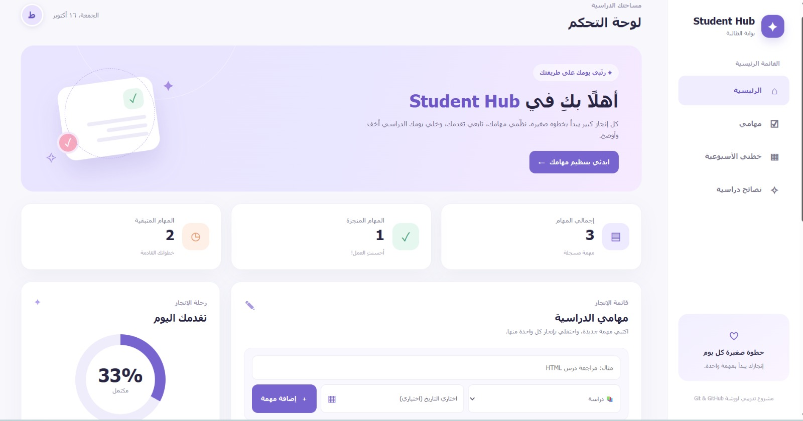
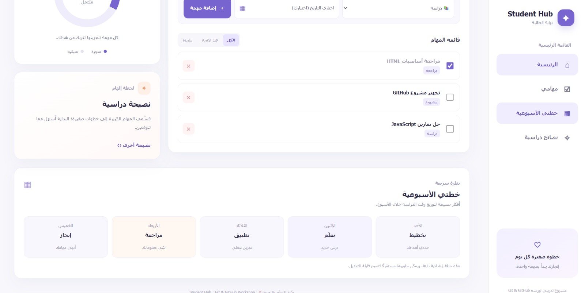

# Student Hub | بوابة الطالبة

موقع عربي يساعد الطالبات على تنظيم المهام الدراسية ومتابعة نسبة الإنجاز بطريقة سهلة ومنظمة.

## مميزات المشروع

- إضافة المهام الدراسية وتصنيفها وتحديد تاريخ اختياري لها.
- تعديل حالة المهام إلى منجزة وحذف المهام.
- متابعة عدد المهام ونسبة الإنجاز.
- عرض خطة أسبوعية إرشادية ونصائح دراسية.
- حفظ المهام محليًا في المتصفح.
## صور من الموقع

### لوحة التحكم الرئيسية

### المهام والخطة الأسبوعية

## التقنيات المستخدمة

- **HTML:** بناء هيكل الموقع.
- **CSS:** تصميم وتنسيق الواجهات.
- **JavaScript:** إدارة المهام والتفاعل مع المستخدم.
- **localStorage:** حفظ بيانات المهام داخل المتصفح.

## طريقة التشغيل

1. اضغط على **Code → Download ZIP** لتنزيل المشروع.
2. فك ضغط الملف.
3. افتح `index.html` في متصفح حديث.

> لا يحتاج المشروع إلى خادم أو قاعدة بيانات، وتُحفظ المهام محليًا دون مزامنة بين الأجهزة.

## طريقة الاستخدام

1. اكتب اسم المهمة واختر تصنيفها وتاريخها إن رغبت.
2. اضغط على **إضافة مهمة**.
3. حدد المهام المنجزة أو احذف المهام غير المطلوبة.
4. تابع نسبة الإنجاز من لوحة التحكم.

---
*مشروع تدريبي ضمن دورة Git وGitHub.*
